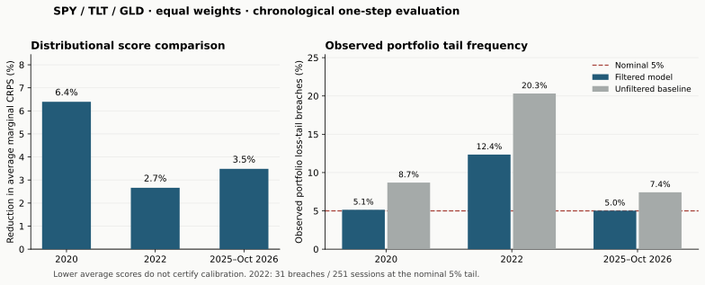

# Synthetic Data — auditable market scenarios

A practical Python engine for **conditional daily, multi-asset price scenarios**.
It fits parsimonious volatility models, resamples historical innovations jointly,
and generates coherent OHLC bars when observed OHLC data are supplied.

Built for portfolio research: explicit assumptions, local random generators,
strict data contracts, chronological evaluation, reproducible artifacts, and
numerical/adversarial regression tests. This is a risk-scenario engine; it does
not forecast alpha or certify a trading strategy.

## Full-path SPY evidence

One-day validation does not certify six-month drawdowns. The new
[`path_validation` module](src/synthetic_market/path_validation.py) evaluates
complete daily paths at 21, 63 and 126 sessions: terminal dispersion, maximum
drawdown, underwater duration, first loss-barrier passage and censored recovery.
It compares the published FHS with iid and stationary-block bootstraps,
conditional historical analogues, a path-area ablation, and an online mixture
that learns only from fully matured forecasts. **The FHS default is unchanged.**

The recorded study has 316 rolling origins, 2,000 paths per origin and method,
and 136 main-sample origins from 2015 onward. At 126 sessions, FHS's nominal
central 90% interval covers **83.09% of realized maximum drawdowns**, versus
92.65% of terminal returns. Seventeen drawdowns fall below its fifth percentile;
six exceed its 95th percentile, and **all six upper breaches share the same
February 2020 peak**. They are not six independent crises. Neither the analogue
models nor the adaptive mixture establishes a six-month improvement over FHS.

Read the [fixed experiment protocol](docs/path_protocol_2026-10-30.md),
[interdisciplinary research and implemented transfers](docs/path_research.md),
and [full empirical report, limitations and reproduction](docs/spy_path_validation_report.md).
The complete suite contains **198 tests**. A separate executable numerical
referee checks results against independent scalar algorithms; it is not human
peer review or a separate language-model certification.

```bash
synthetic-market download --tickers SPY --start 1993-01-01 --end 2026-10-30 \
  --out outputs/spy-input
python -m synthetic_market.path_validation \
  --csv outputs/spy-input/input.csv --metadata outputs/spy-input/input_metadata.json \
  --price-basis adjusted --out outputs/spy-paths
python examples/audit_path_study.py --results outputs/spy-paths \
  --input outputs/spy-input/input.csv --out outputs/path-referee.json
```

Install first using the instructions below. Preserve the input snapshot: Yahoo
can revise history, and a fresh download need not reproduce an earlier snapshot
bit for bit. Every output directory/file must be new. The study is retrospective
rolling-origin evidence, not a prospectively untouched period or production VaR
approval. [Remote full-study reproduction](https://github.com/EugeniSegarra/Synthetic-Data/actions/runs/41037359983).

## Run it

Python 3.11–3.13. From a fresh checkout:

```bash
python -m venv .venv
source .venv/bin/activate
python -m pip install -e ".[yahoo,dev]"
python -m synthetic_market demo --out outputs/demo
```

On Windows, activate with `.venv\Scripts\activate`. The demo works **without
network access** after installation. Its input is an explicitly labeled synthetic
three-asset process, not downloaded market data. Every run needs a new output
directory; existing results are never overwritten.

### Your own data

```bash
synthetic-market simulate --csv my_daily_prices.csv --price-basis adjusted \
  --paths 1000 --horizon 63 --seed 42 --out outputs/my_scenarios

synthetic-market validate --csv my_daily_prices.csv --price-basis adjusted \
  --split-date 2024-12-31 --weights SPY=0.3333333333333333,TLT=0.3333333333333333,GLD=0.3333333333333334 \
  --out outputs/my_validation
```

Accepted CSV formats:

```csv
Date,SPY,TLT,GLD
2024-01-02,100.0,90.0,150.0
2024-01-03,99.5,90.4,151.0
```

or observed bars in long format:

```csv
Date,Asset,Open,High,Low,Close
2024-01-02,SPY,100.0,101.0,99.0,100.5
2024-01-02,TLT,90.0,91.0,89.0,90.5
2024-01-03,SPY,100.3,101.2,99.8,100.8
2024-01-03,TLT,90.3,90.8,89.5,90.0
```

These tiny examples show the schema; fitting requires at least **250 returns**
by default. Use positive, consistently adjusted, consecutive session observations
in one currency with economically compatible closing times. Prices are never
forward-filled. CSV dates must use `YYYY-MM-DD`. API date indexes must be
timezone-naive midnight session labels; map timestamps to the correct local
trading-session date before supplying them. The reader does not silently strip
time zones or truncate intraday timestamps. Incomplete internal sessions are
rejected. Explicit
`--alignment intersection` can trim incomplete **edges** of a sample, not join
across missing sessions. The package cannot discover dates absent from *every*
asset without an external trading calendar.

### Download a reproducible input snapshot

```bash
synthetic-market download --tickers SPY TLT GLD \
  --start 2010-01-01 --end 2026-10-30 --out outputs/market_input

synthetic-market simulate --tickers SPY TLT GLD \
  --start 2010-01-01 --end 2026-10-30 \
  --paths 1000 --horizon 63 --seed 42 --out outputs/market_scenarios
```

The end date is exclusive. Yahoo is an optional research convenience, not an
institutional point-in-time feed. Its adjusted OHLC are downloaded with
`auto_adjust=True` explicitly: **adjusted paths are not historical executable
quotes**. Missing symbols or provider failures are errors; synthetic data never
replace a failed download. Preserve the downloaded CSV and metadata because
providers can revise histories. [Yahoo's API contract](https://ranaroussi.github.io/yfinance/reference/api/yfinance.download.html).

## What the engine actually does

1. Compute daily log returns from the supplied common-date panel.
2. Fit GARCH(1,1) and GJR-GARCH(1,1) by Gaussian quasi-maximum likelihood; with
   the default `--volatility auto`, select the lower-BIC **admissible** fit for
   each asset. `garch` and `gjr` can be requested explicitly.
3. Center and standardize the filtered innovations, record those corrections,
   and check variance stability under that **actual empirical distribution**.
4. Draw whole historical rows. All assets receive shocks from the same observed
   day; marginal tails do not determine an invented copula tail parameter.
5. Propagate each path's conditional volatility from the latest observed state.
   The first returned row includes a new return; a horizon of 63 means 63 moves.
6. With observed OHLC, reuse the same row's normalized log gap and excursions.
   Reconstruct bars multiplicatively, preserving units and OHLC inequalities.

The default daily **log** mean is zero. `--mean constant` estimates a constant
mean from training data. Neither choice estimates expected excess returns; zero
log mean does not imply zero arithmetic expected return. The model is
semiparametric: Gaussian quasi-likelihood estimates the volatility filter, while
the simulated innovation distribution is empirical and generally non-Gaussian.

See [methodology and decisions](docs/methodology.md), the [research review and
19-source bibliography](docs/research.md), and [validation evidence](docs/validation_report.md).

## Outputs you can inspect and reuse

Each complete run is staged and committed to a new directory only after it
succeeds. Depending on the command, the bundle contains:

| File | Purpose |
| --- | --- |
| `input.csv`, `input_metadata.json` | Exact input snapshot and price/source convention. |
| `model.json` | Parameters, selected models, rejected candidates, residual corrections, stability and serial diagnostics. |
| `scenarios.npz` | Numeric path arrays, conditional volatilities and historical row provenance; no pickle required. |
| `scenarios.csv` | Long-form paths and bars; omit with `--no-csv` for larger jobs. |
| `scenario_summary.json` | Terminal return quantiles and a clearly labeled buy-and-hold portfolio scenario summary. |
| `validation.json` | Chronological evaluation against the joint unfiltered-bootstrap reference. |
| `manifest.json` | Seeds, data hash, software versions and artifact checksums. |
| `summary.md` | Compact interpretation of the generated bundle. |

Scenarios use `Path`, `Step`, and `Asset`. A step is a future observation, not a
weekday mislabeled as an exchange session. `ResampledDate` is historical shock
provenance, **not the date a future event is predicted to occur**.

## Validation that can disagree with the model

The validation command fits only through the inclusive split date. It forecasts
one observation, scores it, then updates the volatility state using that newly
observed return. Parameters and empirical innovations stay fixed. The reference
resamples joint unfiltered training returns, centered in the same mean as the
model, so the comparison does not rely on different drift assumptions.

The report includes exact marginal CRPS, multivariate energy and variogram
scores, portfolio quantile/expected-shortfall forecasts, and marginal/joint tail
exceedances. Energy's pairwise term uses a declared reproducible Monte Carlo
estimator; the other empirical forecasts use the full training support. Smaller
scores are better on the **same** test observations. Exceedance counts are not
automatic pass/fail certificates: a 1% tail has only 2.5 expected events in 250
sessions. Details and actual market results are in the
[validation report](docs/validation_report.md).

**A material failure is published, not hidden:** on the equal-weight SPY/TLT/GLD
2022 holdout, the model's nominal 5% loss tail was breached on **31 of 251 days
(12.35%)**, versus 12.55 expected nominally. Lower average distributional scores
than the baseline do not make those probabilities calibrated. This release is
not a substitute for a validated production VaR model.



The report raises a descriptive undercoverage warning when observed breaches
are at least twice the nominal expectation and that expectation is at least ten
events. This is an explicit screening rule, not a significance test. A missing
warning does not establish calibration.

For the dependency versions used in the recorded benchmark, install with
`python -m pip install -c constraints-tested.txt -e '.[yahoo,dev]'`.
The constraints describe the tested Python 3.12 Linux environment; CI also checks
the supported dependency ranges on other Python versions and macOS.

```bash
python -m pytest
ruff check src tests examples
python -m build
```

The regression suite covers exact GJR recurrences, negative valid asymmetry,
first-step indexing, single assets, scale and column-order invariance, OHLC
identities, independent heavy tails, perfect dependence, RNG isolation, leakage,
strict data failures, scores, CSV round trips, and command-line artifact bundles.
The [adversarial review](docs/adversarial_audit.md) separates software acceptance
from statistical and economic claims.

## Boundaries that matter for portfolio work

- **Unseen crises:** empirical standardized shocks have finite historical support.
  Volatility changes can still create larger raw moves, but more paths do not
  discover new joint shock types. Add separate, explicitly specified stress
  analysis when that is the objective.
- **Changing dependence:** residual dependence is frozen within a fitted model.
  No dynamic correlation, regime-switching, parameter-uncertainty, or market
  impact model is implied.
- **OHLC execution:** bars do not tell you whether the high or low occurred first.
  No stop/target ordering, volume, spreads or slippage is simulated. The published
  predictive benchmark evaluates close returns, not intraday strategy execution.
- **Machine learning:** synthetic observations are conditional on fitted
  assumptions. Fit this generator inside the training partition; evaluate
  downstream decisions on untouched real data.
- **Currency and timing:** no FX conversion or synchronization of different
  exchanges is performed. Portfolio weights presume comparable returns in one
  chosen currency.

Recent GAN, signature and diffusion research is covered critically in
[research.md](docs/research.md). This release does not claim to beat every
generator or to be error-free in every possible setting. It publishes a working,
tested model and the evidence needed to assess its defined scope.

## Python API

```python
from synthetic_market.data import make_demo_data, read_csv
from synthetic_market.model import ModelConfig, fit_market
from synthetic_market.validation import evaluate_holdout

data = make_demo_data()  # or read_csv("prices.csv", price_basis="adjusted")
model = fit_market(data, ModelConfig(volatility="auto", mean="zero"))
paths = model.simulate(n_paths=1000, horizon=63, seed=42)
frame = paths.to_frame()
report = evaluate_holdout(data, split_date="2014-12-31", seed=123)
```

`synth_data.py` and the original `datos sinteticos.py` filename are compatibility
entry points to this CLI. The former manual copula classes are retired; the
original implementation remains available in Git history.
